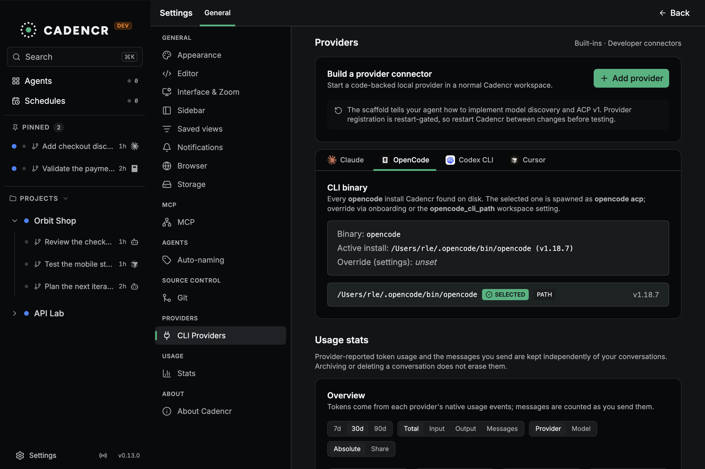

# Provider status — OpenCode (ACP)

> Reviewed against v0.13.0 source and release changes on 2026-10-13, with the
> OpenCode 2.x path added against `@opencode/cli` 2.3.2. This is not an
> end-to-end parity certification of every OpenCode CLI version.

The adapter lives in `packages/service/src/domain/agents/opencode/`. It launches
`opencode acp` and uses the shared `agents/acp/runtime/` for line-delimited
JSON-RPC over stdio. OpenCode-specific hooks stay in `opencode/acp/`.
The transport SDK lives in `packages/opencode-sdk-rs/`.

Two CLI lines are supported. Both install an `opencode` binary and share the
data directory and `opencode.db`; the discovery probe's `--version` picks the
protocol (`opencode_sdk_rs::OpenCodeGeneration`, a version it cannot read keeps
1.x):

- **1.x** (npm `opencode-ai`): `opencode acp --cwd --hostname --port` also
  serves an HTTP backend. Adapter-owned HTTP side channels handle OpenCode
  questions, child-session events/permissions, native shell work, and
  point-in-time branching (`opencode/acp/upstream_workaround/`).
- **2.x** (npm `@opencode/cli`): see [OpenCode 2.x](#opencode-2x). Its
  `opencode acp` speaks stdio only and keeps its server private.

Neither path is the removed legacy long-lived HTTP conversation runtime.

## Coverage

See [FEATURES.md](./FEATURES.md) for the cross-provider ledger and
[CAPABILITY_PROJECTION.md](./CAPABILITY_PROJECTION.md) for projection rules.

| # | Capability | Status | Current path or limitation |
| --- | --- | --- | --- |
| 1 | Modes | ✅ | Plan, Build, and discovered OpenCode agents; acknowledged ACP mode changes |
| 2 | Thinking | ✅ | Thought chunks use a separate runtime thinking block/index |
| 3 | Streaming | ✅ | Shared ACP message/tool lifecycle, with turn-end block closure |
| 4 | Shell tools | ✅ | ACP terminal references enriched with command and output |
| 5 | File changes | ✅ | Edit/Write keys and diff content normalize to the shared input shapes |
| 6 | Subagents | ✅ | Adapter-owned child-to-parent correlation, side-channel updates, and final text |
| 7 | Todo | ✅ | Tool and ACP plan updates normalize and deduplicate within a turn |
| 8 | Thinking changes | ✅ | Negotiated effort configuration; only acknowledged values become current |
| 9 | Model changes | ✅ | Selected model reconciled after setup and changed through ACP config |
| 10 | Permissions/questions | ✅ | Shared ACP gate plus OpenCode question/child-permission bridges |
| 11 | MCP | 🟡 | Injected via ACP session setup; configured servers can retain unknown status |
| 12 | Dedicated plan approval | ❌ | Plan/Build switching exists; no Claude-style `ExitPlanMode` approval handoff |
| 13 | Context usage | ✅ | Authoritative usage/context-window snapshots; no per-turn-total occupancy guess |
| 14 | Compaction | ✅ | Live `/compact` prompt and persisted manual compact boundary |
| 15 | Commands/skills | ✅ | ACP command pushes and a cold per-directory probe |
| 16 | Live follow-up | ✅ | Reuses the active ACP session ID and serializes turns |
| 17 | Durable restore | ✅ | Requires advertised stable resume or legacy load support |

## Mode, model, and effort reconciliation

`opencode/acp/adapter.rs` maps Plan to `plan`, a selected custom agent to its
advertised name, and ordinary supported operation to `build`. The provider
catalog determines which controls the user can select; shared permission modes
are not a claim that every CLI has the same native permission policy.

The session handshake provides the current mode/model and config snapshot.
Initial user selections are applied before the first prompt when required.
Model/effort config changes use the advertised ACP option identity and supported
value. A provider acknowledgment updates the current value; user intent alone
must not masquerade as applied configuration.

New-conversation provider/model selection follows the last accepted manual
prompt across projects, with explicit conversation overrides taking priority.

## Streams, tools, and child sessions

The shared ACP event indexer keeps text and thought streams separate. Tool starts,
updates, completion, cancellation, and turn completion map to provider-neutral
runtime events. Titles/locations/arguments are preserved when the provider emits
them; missing fields must not be invented.

ACP terminal IDs resolve through the session terminal registry so a Bash block
can show its command and stdout/stderr. Edit/Write normalization handles ACP
camelCase inputs and diff content using Cadencr's canonical file-change shapes.

OpenCode Task/Agent completions can synthesize final child text under the parent
tool. The side-channel listener binds child session IDs to parent tool IDs for
live updates and permission routing. `subAgentSessionId` itself is not a parent
tool-use ID.

## Permissions and questions

Standard ACP permission options retain opaque option IDs. Session and future
allow decisions are cached where supported; no-feedback Deny rejects the request.
OpenCode's question sidecar owns answer/deny routing where the upstream question
is not represented as an ordinary ACP permission request.

Plan mode can be changed to Build explicitly. It does not currently produce the
same dedicated plan-approval handoff as Claude Code or Codex. Do not document a
plan gate as available merely because the provider advertises a Plan mode.

## MCP injection and observed status

The shared ACP handshake carries configured MCP servers in `session/new`, stable
`session/resume`, or legacy `session/load`. The old audit's claim that the ACP
path never loads MCP servers because it skips a worktree `opencode.json` writer
no longer describes the implementation.

`OpenCodeAcpAdapter::available_mcp_servers` probes native CLI status through
`opencode_sdk_rs::list_mcp_servers_from_cli`, merges observed entries with the
configured server list, and remembers names for canonical tool normalization.
An unavailable/empty probe leaves configured status intact; it does not mark an
unobserved server connected. Unknown status is therefore a useful limitation,
not proof that a server was omitted from session setup.

Cadencr runtime credentials remain session-scoped. User/project OpenCode
configuration is separate from that injected session configuration.

## Context, compaction, and commands

Context occupancy uses `usage_update.used/size` and session window snapshots.
A `session/prompt` response's turn usage is not substituted for total context
occupancy. Unknown windows show a pending state with known counts.

The live compaction path sends `/compact` and records a manual compact boundary.
ACP `available_commands_update` pushes refresh per-directory command snapshots.
Cold command discovery uses a short-lived ACP probe rather than an unrelated
long-lived `opencode serve` process.

## Durable restore and graceful close

`OpenCodeAcpAdapter::supports_durable_resume()` returns true. The shared lifecycle
then checks the live `initialize` response:

1. Prefer stable `session/resume` when advertised.
2. Fall back to legacy `session/load` when `loadSession` is advertised.
3. Refuse an explicitly requested restore if neither is supported; do not silently
   create a fresh conversation and claim the history was restored.

Stable resume does not replay history. Legacy load may replay updates, which the
host must reconcile. Graceful `session/close` is called when advertised.
OpenCode runtime IDs are opaque nonempty IDs, not Claude UUIDs.

OpenCode 1.x records the directory a session was created in and boots the
session from it, so a session whose folder was renamed or moved opens but fails
every prompt (`OpenCode service failure`, ENOENT on the old folder). Before
restoring, `before_session_resume` (`opencode/acp/session_location.rs`) reads
the session over the subprocess's HTTP server and, when its directory differs
from the conversation's, moves it there
(`POST /experimental/control-plane/move-session`), keeping its id and history.
OpenCode 1.x refuses a directory that belongs to another project. A version
without the route fails the restore with an explanation rather than run the
agent in the recorded folder, which may be the original a copy to another disk
left behind. Both calls time out after 10 seconds. 2.x moves sessions
differently; see [OpenCode 2.x](#opencode-2x).

## OpenCode 2.x

`opencode/acp/v2/` owns the 2.x path. Nothing in it reaches an HTTP side
channel: 2.x `opencode acp` starts a private server on a random port with a
random password.

**Wire translation.** `v2/wire/` sits on the ACP wire through the provider-neutral
`acp::wire_transform` hook and turns 2.x extensions into standard ACP and the
host conventions of `INSTALLED_ACP_PROVIDERS.md`:

| 2.x | Host |
| --- | --- |
| `initialize` | adds `clientCapabilities.elicitation.form` and `_meta["opencode/child-session-updates"]` |
| `elicitation/create` form (one `q<n>` property per question, `q<n>_custom` for free text) | `session/request_permission` for `AskUserQuestion`; the `_meta.updatedInput.answers` reply maps back to `{action: "accept", content}`, a refusal to `decline`, a dismissal to `cancel` |
| `subagent` tool returning `rawOutput.metadata = {sessionID, status: "running"}` | `_meta.cadencr.subagent.background` on the launch acknowledgement |
| `opencode/session/child_update` `status` `created` / `running` | binds the child to its launch: the only pending `subagent` call of its parent, otherwise the acknowledgement naming its `sessionID`; a child opening after the others finished keeps the hold |
| `opencode/session/child_update` `update` | the child's tool calls with ids `<child>:<id>` and `parentToolCallId` = the launching call (held, up to 256, until the launch is known); its reply text is kept |
| `opencode/session/child_update` `status` `completed` / `failed` / `interrupted` | `_meta.cadencr.subagent.status` with the reply (or error) as `summary` |
| prompt ending `end_turn` with children running | `result._meta.cadencr.backgroundWorkPending` |
| a reply streamed after the prompt (a finished child wakes the parent), which 2.x never closes | `usage_update` with `detachedReplyEnded` once `session_v2.time_idle` catches up with `time_busy` and the reply streamed nothing for 750 ms (read-only poll while one is pending); a `session_info_update` releasing the hold follows when no child runs (the host ends only replies that streamed text) or replaces it when no reply comes |
| `$/cancel_request` for an elicitation | the same cancellation for the permission id the host was given |
| file tools' relative `rawInput.path`, in updates and permission requests | absolute `filePath` |
| text output only in `content` | `rawOutput.output` |

Child permission requests already arrive as ordinary `session/request_permission`
on the root session, with the prefixed tool-call id.

**Session configuration.** `OPENCODE_CONFIG_CONTENT` carries Cadencr's
instructions file and turns on 2.x's todo tool (`experimental.todo`, off by
default there), unless the existing content already sets it.
`OPENCODE_ENABLE_QUESTION_TOOL` does not exist in 2.x. Effort levels come from
each model's variants in the catalog; ACP's `effort` option (category
`thought_level`) applies them.

**One-shot commands.** Each passes `--standalone`: without it 2.x starts its
shared background service (`opencode serve --service`) and leaves it running.

| Need | 1.x | 2.x |
| --- | --- | --- |
| Model catalog | `models --verbose` | `api --standalone GET /api/model`, `/api/model/default` |
| Custom agents | `agent list` | `debug agents --standalone` (JSON) |
| Resolved MCP config | `debug config` (one document, `mcp.<name>`) | `debug config --standalone` (array of sources, `mcp.servers.<name>`, `disabled`) |
| Session move | `POST /experimental/control-plane/move-session` on the side channel | `api --standalone POST /api/session/{id}/move` |
| Fork before a prompt | `POST /session/{id}/fork` on the side channel | `api --standalone POST /api/session/{id}/fork` with `before`, the cut found through `GET /api/session/{id}/message?type=user` |
| User shell | native `POST /session/{id}/shell` | Cadencr-managed: runs in Cadencr, attached to the next prompt |
| Update check | npm `opencode-ai@latest` | npm `@opencode/cli@latest` |

`opencode api --standalone` serves the same database as the live ACP process,
which sees what it writes. A failed request exits 1 with the error body on
stdout and `HTTP <status>` on stderr.

**Database.** 2.x migrates the 1.x tables into `session_v2` / `session_message`
(same session and message ids) and keeps the 1.x tables, which then stop
growing. Conversation import and token-history import read 2.x tables first and
add 1.x rows 2.x does not hold yet. With `experimental.part_rows`, assistant
items live in `session_part` (by `ordinal`, ahead of inline `content`). Token
history counts `assistant` and `compaction` rows. A 1.x CLI refuses a database
2.x created from scratch. Release builds use `opencode.db` (or `OPENCODE_DB`);
the idle poll reads that file as the service's environment resolves it.

**Resume.** 2.x refuses `session/resume` from any folder but the session's
recorded one. `v2/session_location.rs` moves a session first; OpenCode applies a
move at once when the recorded folder is gone (a renamed project) and otherwise
queues it for the session's next turn there, so that case fails with an
explanation.

## Rewind and Fork

`opencode/branching.rs` implements `SessionBranching`. An adapter-owned headless
ACP/HTTP path forks the native session before a selected provider message ID,
falling back to the real user-prompt ordinal when necessary.

[Rewind & Fork](../REWIND_AND_FORK.md) handles shared interruption, code checkpoints,
conversation state, and draft restoration. A fork opens a new conversation with
current code in the same worktree. A rewind restores code only when a checkpoint
exists and the restore succeeds. Branch failures abort before the conversation
is replaced with an untrimmed native history.

## Evidence and remaining limitations

- Source anchors: `opencode/mod.rs`, `opencode/acp/{mod,adapter}.rs`,
  `opencode/branching.rs`, and `acp/runtime/lifecycle.rs`.
- Older CLI builds can omit optional config, restore, or close methods. Advertised
  live capabilities and acknowledgments are authoritative.
- The dedicated plan-approval handoff remains absent; use explicit mode switching.
- MCP status can remain unknown even when the configured server was injected.
- The earlier first-cut audit's proposed fixes are historical evidence, not a
  current backlog. Verify a suspected regression against current code/live CLI
  before reintroducing it as an outstanding issue.
